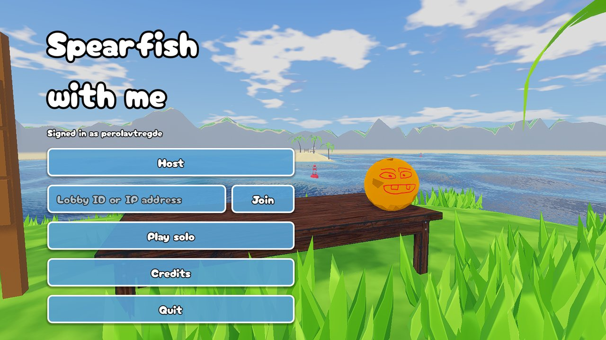
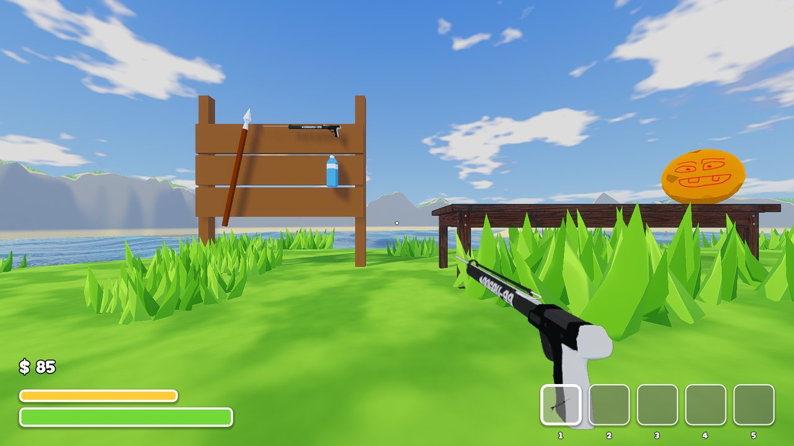
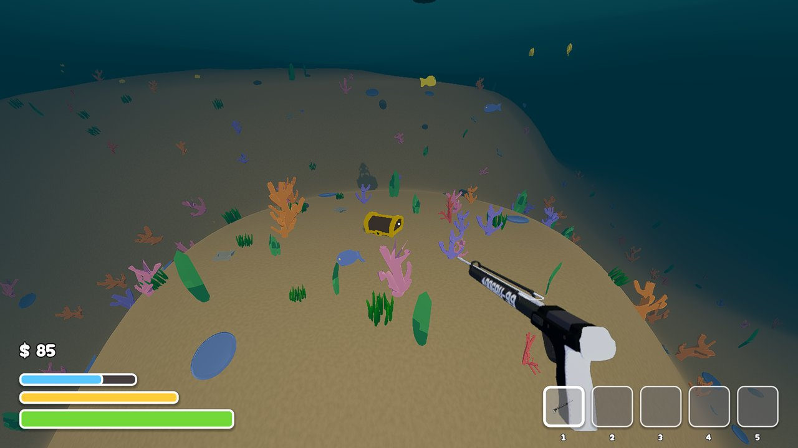
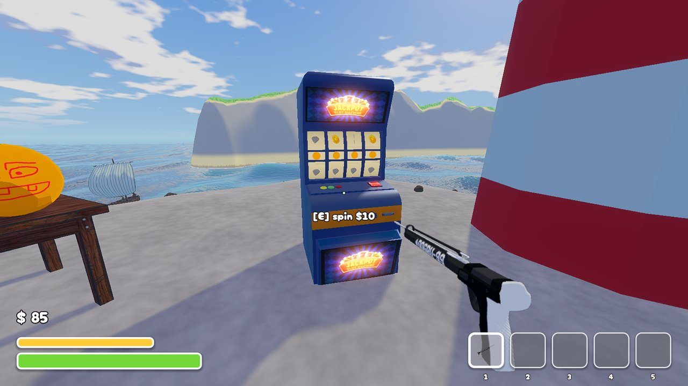

# Spearfish with me

A co-op spearfishing game made in Godot 4.7 for a game jam with the theme **"Hold your breath"**.

Every dive is a race against your lungs. Swim out from the islands, spear fish and grab
treasure, and make it back to the surface before your breath runs out. Sell your catch to
Coco the coconut, buy better gear (a speargun, goggles, flippers) and dive deeper, where the
fish are rarer and the chests hold more gold. Watch out for the sharks, and play solo or
together with friends over Steam.

## How to play

**WASD** to swim and walk, look where you want to go, **left click** to spear, **E** to pick
up, sell and buy, **Q** to drop, **Esc** for the menu.

Assets are credited in the game's **Credits** screen.
